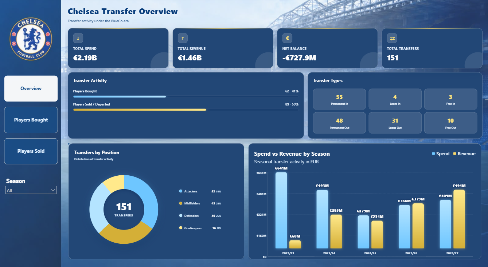
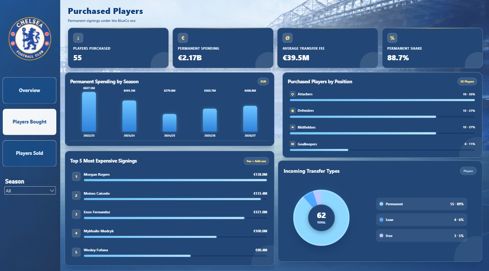
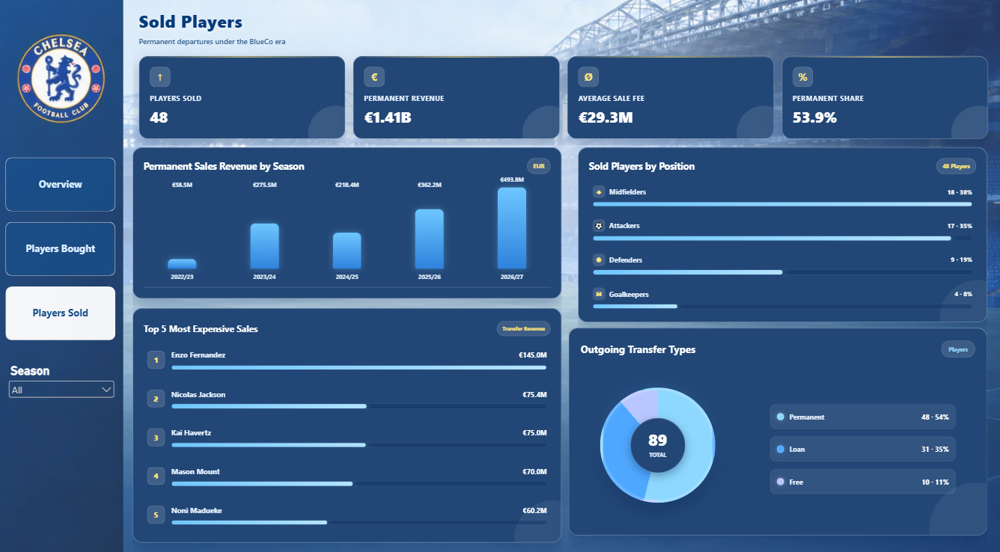

# Chelsea Transfers Analysis

A Power BI dashboard exploring Chelsea FC's incoming and outgoing transfers during the BlueCo era. All financial figures are shown in euros (€).

## Dashboard pages
- **Overview:** Spending, transfer revenue, net balance, and total transfers.
- **Purchased:** Incoming players by season, position, transfer type, and fee.
- **Sold:** Outgoing players by season, transfer type, and fee.

## Tools used
Power BI · Power Query · DAX · HTML Content Visual

## Dashboard preview

## Power BI file
Download [cfc.pbix](cfc.pbix) to explore the dashboard in Power BI Desktop.
